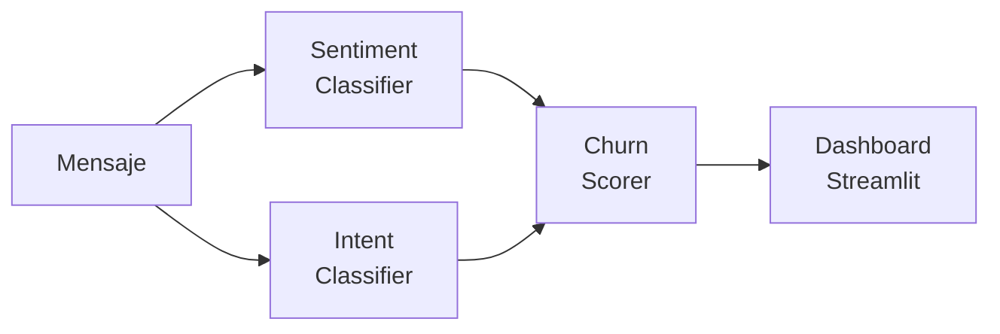

# <!--fit--> ConversaAI

## Sistema de Análisis de Conversaciones de Soporte

**Demo Day** · Mayo 2026

---

# El Problema

- Equipos de soporte reciben **miles de conversaciones/día**
- Detectar **clientes insatisfechos** manualmente es imposible
- El **churn** (abandono) se detecta cuando ya es tarde
- No hay visibilidad sobre **qué intenciones** generan más riesgo

**Solución:** NLP + Machine Learning para analizar cada mensaje en tiempo real

---

# La Propuesta

Pipeline de 3 componentes:

1. 🎭 **Sentimiento** — negativo / neutral / positivo
2. 🎯 **Intención** — 9 clases (cancelación, queja, reembolso, etc.)
3. ⚠️ **Churn Score** — 0 a 1 combinando señales de riesgo

---

# Arquitectura



---

# Stack Tecnológico

| Componente | Tecnología |
|------------|-----------|
| Modelos | XLM-R (fine-tuneado ES/PT) |
| Entrenamiento | Kaggle (GPU T4x2) |
| Dashboard | Streamlit + Plotly |
| Infraestructura | Docker |
| Registro | Hugging Face Hub |

---

# 9 Clases de Intención

| # | Intención | Ejemplo |
|---|-----------|---------|
| 0 | Cancelación | "Quiero cancelar mi suscripción" |
| 1 | Consulta General | "¿Cuál es el horario?" |
| 2 | Facturación/Pago | "Me cobraron dos veces" |
| 3 | Feedback | "Excelente servicio" |
| 4 | Gestión de Cuenta | "Cambiar mi correo" |
| 5 | Modificación Pedido | "Cambiar talla del pedido" |
| 6 | Queja | "Esto es inaceptable" |
| 7 | Reembolso | "Quiero mi dinero" |
| 8 | Seguimiento | "¿Dónde está mi pedido?" |

---

# Churn Score Heurístico

```
churn = sentiment_contrib + frustration_contrib + intent_contrib

sentiment_contrib: probabilidad de negativo * 0.5
frustration_contrib: keywords de urgencia (c/una +0.15, máx 0.3)
intent_contrib: +0.2 si es cancelación/queja/reembolso
```

**Score 0-1.** ≥ 0.7 = alto riesgo de abandono.

---

# Demo en Vivo

## 💬 ConversaAI Dashboard

**[Iniciar demo]**

Análisis en tiempo real de conversaciones de soporte.
Cargar CSV o escribir un mensaje de prueba.

---

# Roadmap

- [x] Pipeline rule-based (fallback) — **Demo**
- [x] Notebooks Kaggle para fine-tuning
- [x] Docker + precarga de modelos
- [ ] Fine-tuning XLM-R en Kaggle
- [ ] Push a Hugging Face Hub
- [ ] Integración con sistema de tickets
- [ ] Alertas en tiempo real (Slack/Webhook)

---

# Gracias

**ConversaAI** — Análisis Inteligente de Conversaciones

[Repositorio](https://github.com/Rox-0864/customer-support-nlp) · [Modelos en HF Hub](https://huggingface.co/Rosela)

---
